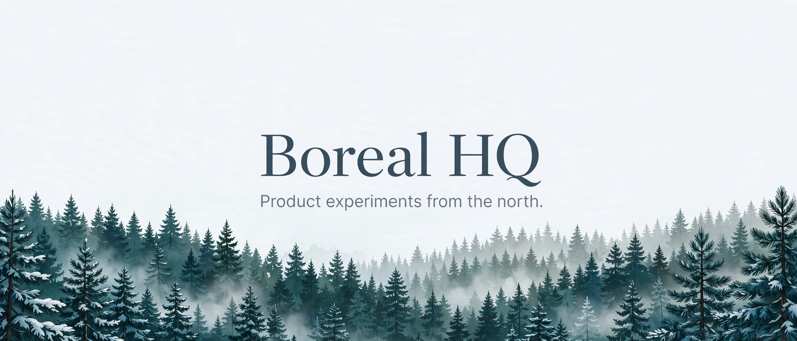

# Hemant Tripathi

### Technical Product Manager

**Product experiments from the north.**

*Based in British Columbia, I build products that solve complex problems while respecting the people who use them.*

 

---

## About

I’m a Technical Product Manager with more than 10 years of experience delivering software in regulated industries, including fintech and banking. I work at the intersection of technology, customer needs, and business strategy—turning complex or ambiguous problems into clear product direction and measurable outcomes.

My work spans product strategy, discovery, and delivery. I partner closely with engineering, data science, design, risk, and compliance teams to shape roadmaps, align stakeholders, and bring reliable, scalable products to market. I bring a technical foundation, a data-informed approach, and a strong focus on execution.

I’m currently open to Technical Product Manager contract opportunities in Vancouver and the surrounding area, including remote and hybrid roles.

## Focus Areas

- **Technical product leadership:** Product strategy, roadmaps, requirements, acceptance criteria, and backlog management for scalable, API-first platforms.
- **AI and machine learning:** Product discovery and delivery for AI- and LLM-enabled features, including evaluation, monitoring, and responsible AI practices.
- **Data-informed decisions:** SQL and Power BI for KPI definition, product reporting, and prioritization.
- **Cross-functional delivery:** Close partnership with engineering, data science, design, risk, and compliance teams to deliver dependable products in regulated environments.

## Core Skills

| Product & Delivery | AI & Machine Learning | Data & Analytics |
| :--- | :--- | :--- |
| Technical product management | Generative AI and LLM product strategy | SQL |
| Product strategy and roadmapping | AI/ML feature development | Power BI |
| REST APIs and OpenAPI/Swagger | LLM evaluation and monitoring | Data analysis and KPI reporting |
| Agile delivery and Scrum | Responsible AI and governance | A/B testing and experimentation |
| User research and discovery | Azure OpenAI | Microsoft Azure |
| Cross-functional leadership | Agentic workflows and automation | Data governance |

## Tools

 

 

Swift · Python · JavaScript · Xcode · Safari · macOS

## Selected Projects

### NeatNest — A Cleaner Safari

<!-- IMAGE PLACEHOLDER — NeatNest
To add the screenshot:

    Upload your file as: assets/neatnest-popup.png
        What to send: NeatNest popup screenshot, about 800 px wide, PNG
        Crop to the popup only, no personal data, no browser chrome if possible
    Delete the placeholder line below it and uncomment the  line.
    No other restructuring needed.
    
    -->

A Safari extension designed to block ads, trackers, and other web clutter. It combines curated filter lists with a lightweight, on-device classifier. NeatNest is built for everyday Safari users, with privacy at its core: it collects no usage telemetry and makes no network calls home.

### Planet Positions at Birth

<!-- IMAGE PLACEHOLDER — Planet Positions at Birth
To add the screenshot:

    Upload your file as: assets/planet-positions-ui.png
        What to send: Planet positions UI screenshot, about 800 px wide, PNG
        Show the local web interface, no personal data
    Delete the placeholder line below it and uncomment the  line.
    No other restructuring needed.
    
    -->

A planet-position calculator with a local web interface, built with an emphasis on precision and verification against reference data. It uses whole-sign houses and is being developed with a flexible interpretation layer rather than relying on fixed if-then rules.

## Contact

- **Email:** [borealhq@proton.me](mailto:borealhq@proton.me)
- **Location:** Surrey, British Columbia, Canada
- **Availability:** Open to Technical Product Manager contract roles in Vancouver, including remote and hybrid opportunities.

*Boreal HQ — independent product work, built with care.*

